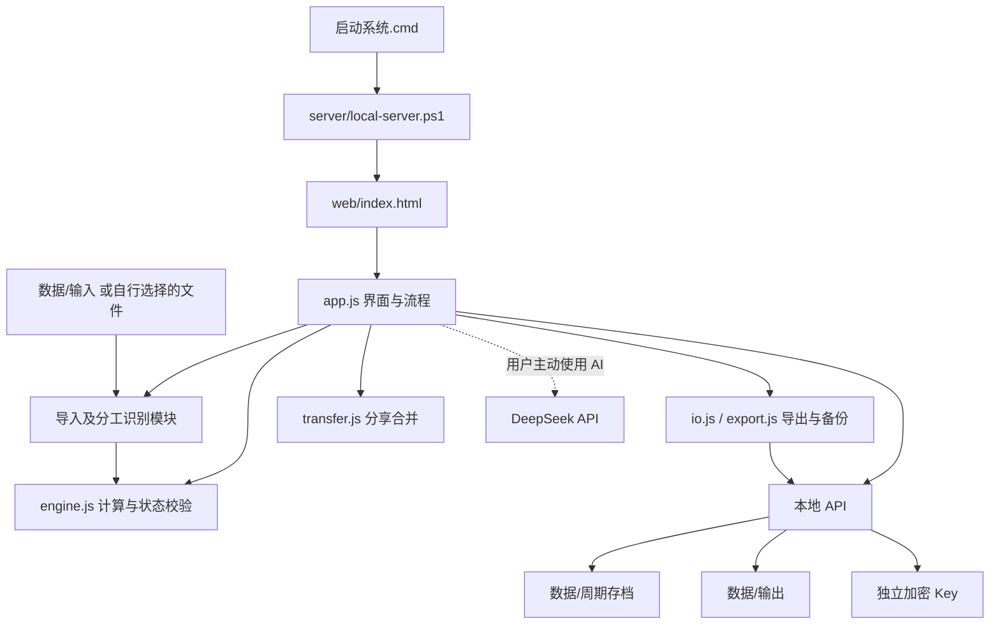

# 系统架构

本系统是“浏览器界面 + Windows 本地文件服务”，不是远程网站。后台仅监听 127.0.0.1 的随机端口，以本次启动的随机路径访问；没有公开网络服务或数据库。Node.js 只用于开发检查。

## 模块职责

| 模块 | 职责 |
| --- | --- |
| app.js | 导航、表单、弹窗、分页、批量操作、提交及本地 API 调用 |
| engine.js | 双月周期、身份匹配、规则、精确金额、分工分配、数据校验及旧版迁移 |
| credits.js | 官微原文的分工、人员、运营/整理等识别 |
| review.js | 项目人员复核、未知分工和选择操作 |
| io.js | Excel 通用解析、官微导出、备份与恢复 |
| import-history.js | 微博人员汇总的导入记录与移除清理 |
| video-import.js | 视频组活动及视频制作 Excel、日期、时长、岗位解析 |
| video-history.js | 两类视频的导入记录和来源清理 |
| export.js | 全表及分组 Excel，布局、原生公式、个人汇总 |
| transfer.js | 分享包、来源规则、跨电脑身份映射、重合检查、合并和批次移除 |
| local-server.ps1 | 启动复用、本地 HTTP、原子存档、输出文件、DPAPI Key 和退出 |

页面按 index.html 中的顺序加载，第三方库先加载，计算引擎先于所有业务模块，app.js 最后加载。模块通过 FeeEngine、FeeIO、FeeExport 等命名对象协作。目录整理只修改文件引用与后台根目录，不重写金额和业务逻辑。

## 数据流与接口

浏览器中编辑 → engine 校验/计算 → 本地 api/state 保存 → 完整存档及各周期镜像。导出 → api/export → 数据/输出。导入文件 → 内存解析/人工确认 → 保存结构化数据；不自动保存原始 Excel 文件。

| 接口 | 操作 |
| --- | --- |
| api/status | 后台身份、根目录及能力检查 |
| api/state | GET 读取；POST 校验后保存 |
| api/key | GET 读取；POST 当前 Windows 用户加密保存；DELETE 清除 |
| api/export?name=... | POST 保存 Excel、备份或分享文件 |
| api/shutdown | POST 停止服务 |

静态请求只能读取 web/ 内的资源，server、tests、docs、templates 及数据文件都不通过 HTTP 公开。本地密钥不进入业务状态、Excel、备份和分享文件。

## 数据与周期

状态版本为 2，类型 reporter-fee。主要集合为 rosters、works、rules、导入记录及分享记录；旧版存档通过 engine 迁移。存档格式保持兼容。固定双月周期为 2–3、4–5、6–7、8–9、10–11、12–次年1月。

金额以分及有理数计算，均分、兼任、空缺岗位、奖励档位和实际发放截断均由 engine 统一处理。导出和个人汇总从同一计算结果生成。传入项目保留来源规则，合并不覆盖其他批次；删除分享批次只清除该批拥有的数据。

## 运行数据隔离

每个根目录独立保存“数据”及 .runtime.json，不依赖浏览器永久存储来保存稿费；sessionStorage 仅用于当前页面刷新导航。发布版本中这些目录是空的。移动项目之前应退出系统，释放后台占用。
